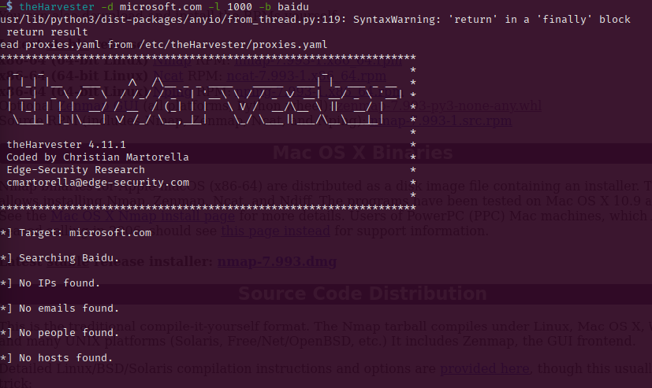
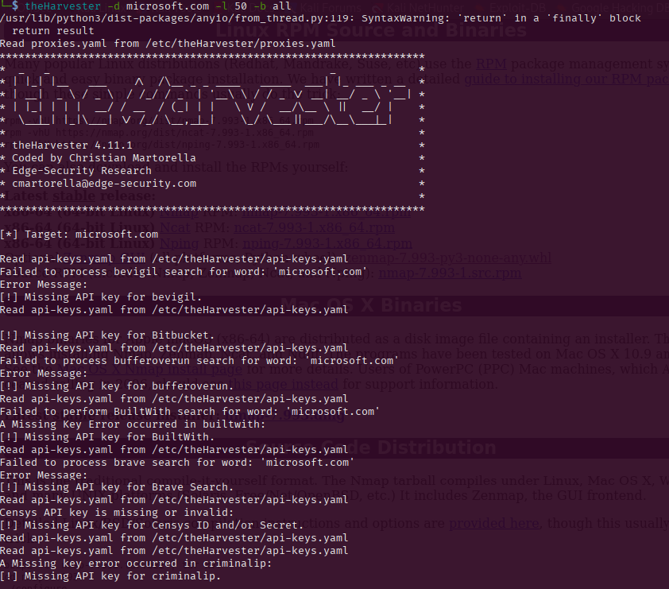
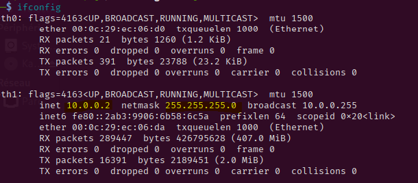
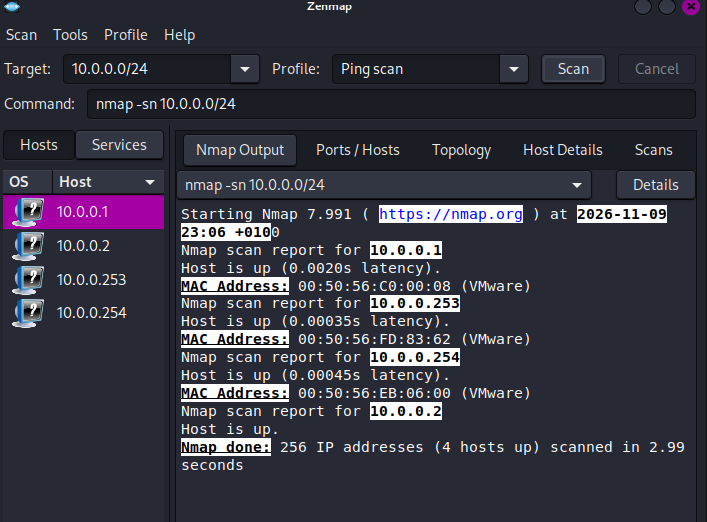
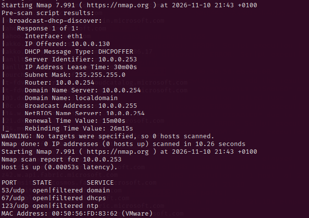
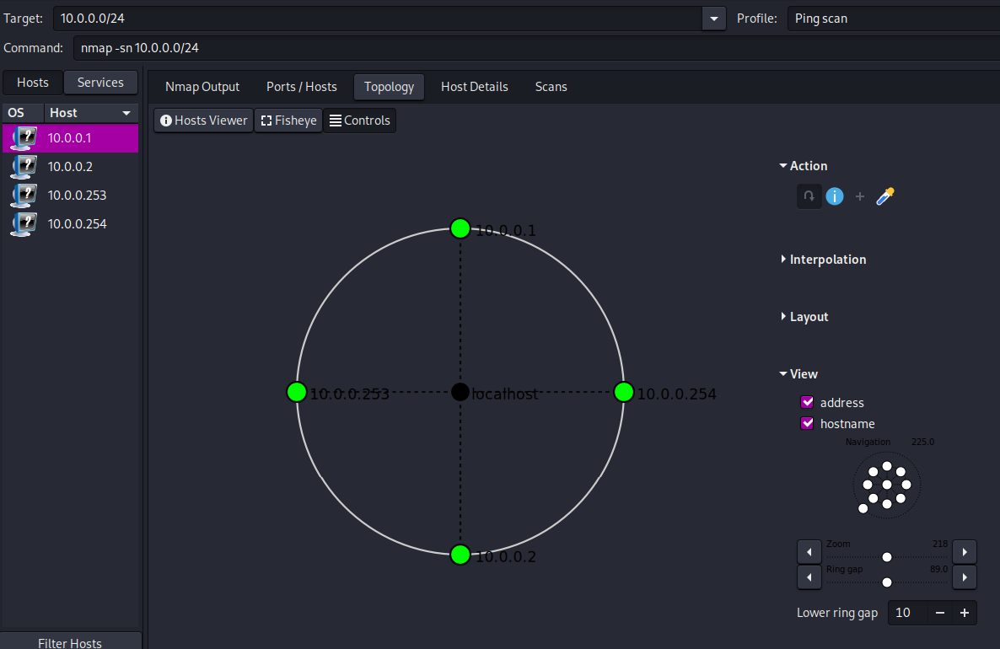

# Penetration Testing Report – Footprinting & Network Scanning (Week 2)

🇬🇧 [English](#english) | 🇫🇷 [Français](#français)

---

## English

### Report information

| Item | Value |
|---|---|
| Program / Batch | Cybersecurity program, Networkwalks – B084 |
| Date | 10 November 2026 |
| Modules completed | W2-PM4 (Footprinting with theHarvester), W2-PM5 (Zenmap Scanning) |
| Targets | 1. `microsoft.com` (target assigned by the exercise, public sources only) 2. My own lab network (VMware NAT, `10.0.0.0/24`) |
| Phases covered | Phase 1: Reconnaissance & Footprinting, Phase 2: Scanning & Network Discovery, Phases 3–5: in progress |

### Disclaimer

These activities were performed only on systems I own or where I had permission (the assigned educational lab). This material is for education and research only. Do not use it to break the law: unauthorized access is a crime even when nothing is damaged.

### Introduction

This report covers footprinting the `microsoft.com` domain with theHarvester (W2-PM4) and scanning my own lab network with Zenmap (W2-PM5). Together they show how an attacker moves from gathering public information to mapping live hosts on a network.

Everything was run on Kali Linux (Purple) in VMware Workstation, on the subnet `10.0.0.0/24`. The practical asked for Zenmap on a Windows PC, but I ran it on the same Kali VM because all the tools of the lab are installed there.

### Tools used

| Tool | Purpose |
|---|---|
| Kali Linux (Purple) & VMware | Operating system and virtual lab |
| theHarvester | Collect emails, subdomains and hosts from public sources (OSINT) |
| Baidu / all sources | Search engine (Task 1), then every available source (Task 2) |
| Zenmap (Nmap GUI) | Find live hosts, IPs and MAC addresses on the subnet |
| Nmap (command line) | Investigate a host further: DHCP discovery, UDP and TCP scans |
| Ping Scan profile | Host discovery only, no port scan |
| Zenmap Topology view | Display the discovered hosts as a network map |

### Activities performed

#### 1. Footprinting with theHarvester (W2-PM4)

theHarvester collects emails and subdomains from public sources, so it is passive: it does not send traffic to the target's own systems.

**Task 1: Baidu, limit of 1000 results**

```bash
theHarvester -d microsoft.com -l 1000 -b baidu
```

The tool returned **no results** (no emails, no subdomains). This only means that this single source gave nothing, not that the domain has no public exposure.



**Task 2: all sources, limit of 50 results**

```bash
theHarvester -d microsoft.com -l 50 -b all
```

theHarvester displayed many **"missing API key"** warnings: about 30 sources need an API key and none was configured, so they could not be used. The other sources (for example Baidu, CRT.sh, Certspotter, Hackertarget, DuckDuckGo, Urlscan, Hudson Rock) still returned results:

| Result | Count |
|---|---|
| ASNs | 7 |
| IP addresses | 162 |
| Email addresses | 3 |
| Hosts | 9,968 |
| Interesting URLs | 4 |
| LinkedIn users | 0 |

The 3 email addresses (`dotnet-docker-bot@microsoft.com`, `opencode@microsoft.com`, `secure@microsoft.com`) appear to be generic or bot addresses rather than personal employee addresses.



Even with about 30 sources unavailable, the run returned a large amount of public information without sending any traffic to the target. A run with API keys configured could return more.

#### 2. Network scanning with Zenmap (W2-PM5)

I first identified the network configuration of the Kali VM (static address `10.0.0.2/24` on the NAT network `10.0.0.0/24`), then scanned the subnet in Zenmap with the **Ping Scan** profile.



The scan found four live hosts:

| IP | MAC address | Role |
|---|---|---|
| `10.0.0.1` | `00:50:56:C0:00:08` | VMnet8 virtual adapter of the host PC |
| `10.0.0.2` | `00:0c:29:ec:06:da` | My Kali VM |
| `10.0.0.253` | `00:50:56:FD:83:62` | DHCP server of the VMware network (confirmed with Nmap, see below) |
| `10.0.0.254` | `00:50:56:EB:06:00` | NAT gateway I configured |

All MAC addresses use VMware prefixes (`00:50:56`, `00:0c:29`), which is expected in a VMware lab.



The device at `10.0.0.253` was not among the devices I configured, so I investigated it from Kali. `ip neigh show 10.0.0.253` confirmed its MAC address (VMware prefix). A first scan returned nothing, so I sent a DHCP discovery broadcast:

```bash
sudo nmap --script broadcast-dhcp-discover
```

The response showed that `10.0.0.253` is the **DHCP server** of the VMware network: it offered the address `10.0.0.130` and announced the router and DNS server `10.0.0.254` and the domain `localdomain`.

```bash
sudo nmap -sU -p 53,67,123 -Pn 10.0.0.253
sudo nmap -Pn -p- --min-rate 1000 10.0.0.253
```

The UDP scan showed ports 53, 67 and 123 as open|filtered, and the full TCP scan found all 65535 ports filtered, which explains why my first scan returned nothing.



I then opened the **Topology** section of Zenmap and captured the network map.



### Risk analysis

| # | Finding | Evidence | Impact | Level |
|---|---|---|---|---|
| 1 | Limited public exposure through Baidu | Task 1 returned no emails or subdomains | Little exposure through this source, but one source is not conclusive | 🟡 Low |
| 2 | Public information found with all sources | Task 2 returned 3 emails, 162 IPs, 7 ASNs and 9,968 hosts | An attacker can map the domains, hosts and IP ranges of an organization without touching its systems; emails can help phishing | 🟠 Medium |
| 3 | Coverage limited by missing API keys | About 30 sources could not be used | Skipped sources may hide more exposed data, so no result is not proof of no exposure | 🟡 Low |
| 4 | Several live hosts discoverable | Ping Scan found 4 hosts | A simple scan maps the devices on the subnet | 🟡 Low |
| 5 | DHCP server discoverable | DHCP discovery identified `10.0.0.253` as the DHCP server; all its TCP ports were filtered | Anyone on the subnet can learn the network settings (router, DNS, domain) with a simple DHCP broadcast | 🟡 Low |
| 6 | MAC addresses reveal the platform | VMware prefixes `00:50:56` and `00:0c:29` | Helps fingerprint hosts as VMware VMs | 🟡 Low |

These are observations, not confirmed vulnerabilities. Only information gathering and host discovery were performed: no exploitation or vulnerability validation.

### Recommendations

1. **Review publicly exposed information:** regularly check which emails and subdomains of a domain can be found publicly.
2. **Remove unused subdomains:** forgotten subdomains can become unmonitored entry points.
3. **Use all sources when assessing exposure:** configure API keys for OSINT tools, since skipped sources can hide data.
4. **Perform regular internal network discovery** to identify active devices.
5. **Identify every device on the network:** investigate any unexpected host, as I did for the DHCP server at `10.0.0.253`.
6. **Maintain network documentation** (IP, MAC, role of each device).
7. **Test only with authorization.**

### Conclusion

With theHarvester, I learned that results depend heavily on the sources used: Baidu returned nothing, while the run on all sources returned 3 emails, 162 IP addresses and thousands of hosts even though about 30 sources were unavailable because of missing API keys. With Zenmap, I discovered four live hosts on my lab network, collected their IP and MAC addresses and viewed the topology, and I saw how important it is to identify every host that appears on a network: an unknown host turned out to be the DHCP server of the VMware network. Reconnaissance and scanning must always stay within an authorized scope.

---

## Français

### Informations sur le rapport

| Élément | Valeur |
|---|---|
| Programme / Batch | Programme cybersécurité Networkwalks – B084 |
| Date | 10 novembre 2026 |
| Modules réalisés | W2-PM4 (Footprinting avec theHarvester), W2-PM5 (Scan avec Zenmap) |
| Cibles | 1. `microsoft.com` (cible imposée par l'exercice, sources publiques uniquement) 2. Mon propre réseau de lab (VMware NAT, `10.0.0.0/24`) |
| Phases couvertes | Phase 1 : reconnaissance et footprinting, Phase 2 : scan et découverte réseau, Phases 3 à 5 : en cours |

### Avertissement

Ces activités ont été réalisées uniquement sur des systèmes que je possède ou pour lesquels j'avais une autorisation (le lab pédagogique imposé). Ce contenu est destiné à l'apprentissage et à la recherche. Un accès non autorisé est un délit, même si rien n'est endommagé.

### Introduction

Ce rapport couvre le footprinting du domaine `microsoft.com` avec theHarvester (W2-PM4) et le scan de mon réseau de lab avec Zenmap (W2-PM5). Ensemble, ils montrent comment un attaquant passe de la collecte d'informations publiques à la cartographie des hôtes actifs d'un réseau.

Tout a été fait sur Kali Linux (Purple) dans VMware Workstation, sur le sous-réseau `10.0.0.0/24`. L'exercice demandait Zenmap sur un PC Windows, mais je l'ai lancé sur la même VM Kali, car tous les outils du lab y sont installés.

### Outils utilisés

| Outil | Rôle |
|---|---|
| Kali Linux (Purple) & VMware | Système d'exploitation et lab virtuel |
| theHarvester | Collecter emails, sous-domaines et hôtes depuis des sources publiques (OSINT) |
| Baidu / all sources | Moteur de recherche (tâche 1), puis toutes les sources disponibles (tâche 2) |
| Zenmap (interface Nmap) | Trouver les hôtes actifs, leurs IP et adresses MAC sur le sous-réseau |
| Nmap (ligne de commande) | Investiguer un hôte : découverte DHCP, scans UDP et TCP |
| Profil Ping Scan | Découverte des hôtes uniquement, sans scan de ports |
| Vue Topology de Zenmap | Afficher les hôtes découverts sous forme de carte réseau |

### Activités réalisées

#### 1. Footprinting avec theHarvester (W2-PM4)

theHarvester collecte des emails et sous-domaines depuis des sources publiques, c'est donc un outil passif : il n'envoie pas de trafic vers les systèmes de la cible.

**Tâche 1 : Baidu, limite de 1000 résultats**

```bash
theHarvester -d microsoft.com -l 1000 -b baidu
```

L'outil n'a renvoyé **aucun résultat** (ni emails, ni sous-domaines). Cela montre seulement que cette source seule n'a rien donné, pas que le domaine n'a aucune exposition publique.


**Tâche 2 : toutes les sources, limite de 50 résultats**

```bash
theHarvester -d microsoft.com -l 50 -b all
```

theHarvester a affiché de nombreux avertissements **« missing API key »** : environ 30 sources demandent une clé d'API et aucune n'était configurée, elles n'ont donc pas pu être utilisées. Les autres sources (par exemple Baidu, CRT.sh, Certspotter, Hackertarget, DuckDuckGo, Urlscan, Hudson Rock) ont quand même renvoyé des résultats :

| Résultat | Nombre |
|---|---|
| ASN | 7 |
| Adresses IP | 162 |
| Adresses email | 3 |
| Hôtes | 9 968 |
| URLs intéressantes | 4 |
| Utilisateurs LinkedIn | 0 |

Les 3 adresses email (`dotnet-docker-bot@microsoft.com`, `opencode@microsoft.com`, `secure@microsoft.com`) semblent être des adresses génériques ou de bots, plutôt que des adresses personnelles d'employés.


Même avec environ 30 sources indisponibles, l'exécution a renvoyé beaucoup d'informations publiques sans envoyer de trafic vers la cible. Avec des clés d'API configurées, elle pourrait en renvoyer plus.

#### 2. Scan réseau avec Zenmap (W2-PM5)

J'ai d'abord identifié la configuration réseau de la VM Kali (adresse statique `10.0.0.2/24` sur le réseau NAT `10.0.0.0/24`), puis scanné le sous-réseau dans Zenmap avec le profil **Ping Scan**.


Le scan a trouvé quatre hôtes actifs :

| IP | Adresse MAC | Rôle |
|---|---|---|
| `10.0.0.1` | `00:50:56:C0:00:08` | Carte virtuelle VMnet8 du PC hôte |
| `10.0.0.2` | `00:0c:29:ec:06:da` | Ma VM Kali |
| `10.0.0.253` | `00:50:56:FD:83:62` | Serveur DHCP du réseau VMware (confirmé avec Nmap, voir plus bas) |
| `10.0.0.254` | `00:50:56:EB:06:00` | Passerelle NAT que j'ai configurée |

Toutes les adresses MAC ont des préfixes VMware (`00:50:56`, `00:0c:29`), ce qui est normal dans un lab VMware.


L'appareil `10.0.0.253` ne faisait pas partie de ceux que j'ai configurés, je l'ai donc investigué depuis Kali. `ip neigh show 10.0.0.253` a confirmé son adresse MAC (préfixe VMware). Un premier scan n'a rien renvoyé, j'ai donc envoyé une requête de découverte DHCP :

```bash
sudo nmap --script broadcast-dhcp-discover
```

La réponse a montré que `10.0.0.253` est le **serveur DHCP** du réseau VMware : il a proposé l'adresse `10.0.0.130` et annoncé le routeur et le serveur DNS `10.0.0.254` ainsi que le domaine `localdomain`.

```bash
sudo nmap -sU -p 53,67,123 -Pn 10.0.0.253
sudo nmap -Pn -p- --min-rate 1000 10.0.0.253
```

Le scan UDP a montré les ports 53, 67 et 123 en open|filtered, et le scan TCP complet a trouvé les 65535 ports filtrés, ce qui explique pourquoi mon premier scan n'avait rien renvoyé.


J'ai ensuite ouvert la section **Topology** de Zenmap et capturé la carte du réseau.


### Analyse des risques

| # | Constat | Preuve | Impact | Niveau |
|---|---|---|---|---|
| 1 | Exposition publique limitée via Baidu | La tâche 1 n'a renvoyé ni emails ni sous-domaines | Peu d'informations exposées via cette source, mais une seule source n'est pas concluante | 🟡 Faible |
| 2 | Informations publiques trouvées avec toutes les sources | La tâche 2 a renvoyé 3 emails, 162 IP, 7 ASN et 9 968 hôtes | Un attaquant peut cartographier les domaines, hôtes et plages IP d'une organisation sans toucher à ses systèmes ; les emails peuvent aider au phishing | 🟠 Moyen |
| 3 | Couverture limitée par les clés d'API manquantes | Environ 30 sources n'ont pas pu être utilisées | Les sources ignorées peuvent cacher plus de données exposées : l'absence de résultat ne prouve pas l'absence d'exposition | 🟡 Faible |
| 4 | Plusieurs hôtes actifs découvrables | Le Ping Scan a trouvé 4 hôtes | Un simple scan cartographie les appareils du sous-réseau | 🟡 Faible |
| 5 | Serveur DHCP découvrable | La découverte DHCP a identifié `10.0.0.253` comme serveur DHCP ; tous ses ports TCP étaient filtrés | N'importe quel appareil du sous-réseau peut apprendre les paramètres réseau (routeur, DNS, domaine) avec un simple broadcast DHCP | 🟡 Faible |
| 6 | Les adresses MAC révèlent la plateforme | Préfixes VMware `00:50:56` et `00:0c:29` | Permet d'identifier les hôtes comme des VM VMware | 🟡 Faible |

Ce sont des observations, pas des vulnérabilités confirmées. Seules la collecte d'informations et la découverte d'hôtes ont été réalisées : aucune exploitation ni validation de vulnérabilité.

### Recommandations

1. **Vérifier les informations exposées publiquement :** contrôler régulièrement quels emails et sous-domaines d'un domaine sont trouvables publiquement.
2. **Supprimer les sous-domaines inutilisés :** un sous-domaine oublié peut devenir un point d'entrée non surveillé.
3. **Utiliser toutes les sources pour évaluer l'exposition :** configurer les clés d'API des outils OSINT, car les sources ignorées peuvent cacher des données.
4. **Faire régulièrement une découverte du réseau interne** pour identifier les appareils actifs.
5. **Identifier chaque appareil du réseau :** investiguer tout hôte inattendu, comme je l'ai fait pour le serveur DHCP `10.0.0.253`.
6. **Tenir à jour la documentation réseau** (IP, MAC, rôle de chaque appareil).
7. **Ne tester qu'avec autorisation.**

### Conclusion

Avec theHarvester, j'ai appris que les résultats dépendent beaucoup des sources utilisées : Baidu n'a rien renvoyé, alors que l'exécution sur toutes les sources a renvoyé 3 emails, 162 adresses IP et des milliers d'hôtes, même avec environ 30 sources indisponibles faute de clés d'API. Avec Zenmap, j'ai découvert quatre hôtes actifs sur mon réseau de lab, collecté leurs IP et adresses MAC et consulté la topologie, et j'ai vu l'importance d'identifier chaque hôte qui apparaît sur un réseau : un hôte inconnu s'est révélé être le serveur DHCP du réseau VMware. La reconnaissance et le scan doivent toujours rester dans un périmètre autorisé.
